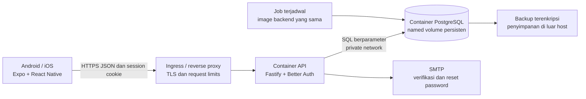

# Arsitektur Sistem — Cash Flow

Versi 0.2 · Arsitektur MVP Android/iOS, backend mandiri, PostgreSQL, dan Docker.

Implementasi lokal tersedia pada `apps/api`, `apps/mobile`, `packages/contracts`, `migrations`, dan `compose.yaml`. [Operasi aktual](OPERATIONS.md) dan [bukti pemeriksaan](IMPLEMENTATION.md) melengkapi rancangan ini. Polling saat ini membaca query aktif setiap 15 detik, belum mengoptimalkan revision-only. Penghapusan akun memakai worker durable dengan perubahan identitas/auth dalam satu transaksi PostgreSQL; tidak memerlukan layanan penghapusan eksternal. TLS ingress dan penyimpanan backup terenkripsi pada diagram adalah kebutuhan deployment publik, belum diaktifkan oleh Compose lokal.

## 1. Gambaran sistem



Satu backend modular dan satu PostgreSQL cukup untuk pilot. Tidak ada akses database dari mobile, Supabase, microservices, Redis, broker pesan, atau WebSocket pada MVP. Implementasi awal mempoll query aktif; polling metadata revision adalah optimasi berikutnya jika diperlukan.

## 2. Modul dan interface

Istilah modul, interface, dan seam mengikuti skill codebase-design. Setiap modul menyembunyikan validasi, query, dan konsistensi operasinya di balik interface use case yang kecil; jangan membuat wrapper pass-through per query.

| Modul | Interface yang dipakai caller | Implementation dan tanggung jawab |
| --- | --- | --- |
| Identitas | session, profil aktif, pengajuan penghapusan | Adapter Better Auth, pemetaan ke profil, verifikasi email, lifecycle |
| Household | buat, undang/terima, ubah anggota, alih owner | Permission, singleton owner, undangan, lock dan revision |
| Pencatatan | kelola rekening/kategori, simpan/koreksi/hapus transaksi | Money validation, composite FK, idempotency, version check, audit |
| Anggaran/laporan | anggaran bulanan, ringkasan, daftar dan ekspor | Query dari account_effects yang sama, filter dan pagination |

Seam eksternal adalah handler HTTP. Pengujian use case dan HTTP melintasi interface yang dipakai aplikasi; PostgreSQL sungguhan digunakan untuk verifikasi konsistensi. SMTP adalah adapter eksternal yang dapat diganti dengan inbox development. Tidak perlu repository generik atau banyak adapter hipotetis.

## 3. Struktur repository yang direncanakan

```text
apps/
  mobile/                 # Expo Router, layar, fitur, akses HTTP
  api/                    # Fastify, modul domain, query, auth
packages/
  contracts/              # JSON Schema dan tipe wire yang benar-benar dibagi
migrations/               # Migration auth dan domain berurutan
docs/                     # Dokumen rancangan
Dockerfile                # Build multi-stage backend
compose.yaml              # api, db, dan migration job lokal
```

Gunakan npm workspaces dengan satu lockfile. Folder tersebut telah dibuat; `packages/contracts` dipakai mobile dan backend untuk kontrak uang, tanggal, dan DTO. Server tidak membagikan SQL, secret, atau model internal ke bundle mobile.

## 4. Autentikasi dan trust

Gunakan Better Auth pada backend dan adapter Expo pada mobile. Library mengelola credential dan session; backend memvalidasi session melalui library pada setiap request terlindungi. Tidak menyusun hash password atau JWT/session framework sendiri.

Mobile memakai SecureStore melalui adapter resmi. Request domain harus membawa session cookie menggunakan mekanisme yang didukung adapter; jangan mengasumsikan cookie browser otomatis terkirim oleh fetch native. Konfigurasi origin/deep link hanya mengizinkan domain dan scheme environment terkait. Tidak menggunakan wildcard development di production.

Email harus terverifikasi sebelum pengguna membaca/mengubah household. Password reset/verifikasi memakai SMTP dengan respons yang tidak membocorkan apakah email terdaftar. Rate limit auth memakai storage database dari library, bukan memori container yang hilang saat restart. Nonaktifkan server-side session cookie cache jika membuat pencabutan akses tertunda.

Session membuktikan identitas, bukan hak household. Setiap query tenant tetap memeriksa membership aktif dan status profil/household. Jangan mempercayai role atau household aktif dari client. Resource luar tenant tidak mengungkap detail melalui pesan error.

## 5. Alur menulis transaksi

```mermaid
sequenceDiagram
    participant U as Mobile
    participant A as API
    participant D as PostgreSQL
    U->>A: POST transaksi + Idempotency-Key
    A->>A: Session, schema, profil
    A->>D: BEGIN; lock household; cek membership
    A->>D: Claim key dan periksa hash
    alt Hasil sukses sudah ada
        D-->>A: ID dan versi hasil awal
    else Mutation baru
        A->>D: Validasi referensi dan versi
        A->>D: Simpan transaksi + audit + revision + hasil key
    end
    A->>D: COMMIT
    A-->>U: ID, version, household_revision
    U->>A: Muat ulang data terkait
```

Gunakan satu koneksi dari pool untuk BEGIN sampai COMMIT/ROLLBACK; jangan menjalankan langkah transaksi melalui koneksi pool yang berbeda. Mutation per household diserialkan melalui row lock untuk correctness MVP. Tunggu koneksi/lock dibatasi dan error dibuat dapat ditindaklanjuti.

Mobile tidak menampilkan saldo final secara optimistis sebelum server mengonfirmasi. Ia boleh menampilkan “Menyimpan…” pada formulir. Timeout setelah pengiriman merupakan hasil belum diketahui: pertahankan payload/kunci, lalu retry mutation yang sama. Mengubah payload berarti mutation baru setelah hasil sebelumnya diketahui.

## 6. Kontrak HTTP awal

Path domain memakai `/v1`; auth dikelola library pada `/api/auth/*`. Seluruh endpoint household berada di bawah `/v1/households/{household_id}` dan mengikuti permission PRD.

| Interface | Operasi |
| --- | --- |
| `/v1/me` | GET profil dan daftar household yang dapat diakses |
| `/v1/me/invitations` | GET undangan pending untuk email terverifikasi pengguna |
| `/v1/me/deletion-requests` | POST pengajuan, GET status |
| `/v1/households` | POST pembuatan household beserta owner dan kategori awal |
| `/{h}` | GET detail, PATCH nama, DELETE household dengan konfirmasi |
| `/{h}/members`, `/{h}/members/{id}` | GET daftar, DELETE pencabutan anggota |
| `/{h}/leave`, `/{h}/ownership` | POST keluar / pengalihan owner |
| `/{h}/invitations`, `/{h}/invitations/{id}` | POST/GET undangan oleh owner, DELETE pencabutan |
| `/v1/invitations/{id}`, `/v1/invitations/{id}/accept` | GET preview terbatas, POST terima; wajib email tujuan |
| `/{h}/accounts`, `/{h}/categories` | GET/POST; PATCH item untuk koreksi/arsip |
| `/{h}/transactions`, `/{h}/transactions/{id}` | GET/POST, GET/PATCH/DELETE item |
| `/{h}/budgets`, `/{h}/budgets/{id}` | GET/POST, PATCH/DELETE item |
| `/{h}/summary`, `/{h}/reports/categories` | GET ringkasan dan rincian kategori |
| `/{h}/audit-events`, `/{h}/exports/transactions.csv` | GET audit dan CSV sesuai akses |
| `/{h}/sync` | GET revision dan status membership terkini |

`/{h}` pada tabel adalah singkatan prefix household, bukan route literal. Parameter filter: `from` inklusif, `to` eksklusif, `type`, `account_id`, `category_id`, `created_by`, `q`, `cursor`, dan `limit` sesuai endpoint. Summary beranda hanya memakai periode dan selalu memisahkan saldo saat ini dari arus kas periode.

Semua mutation domain memakai `Idempotency-Key` UUID; edit/hapus memakai `expected_version` resource terkait, termasuk membership/undangan. Identitas actor, version baru, dan revision ditetapkan server. Hasil mutation household ringkas:

```json
{"data":{"id":"<uuid>","version":2,"household_revision":"14"}}
```

Contoh payload transfer, ID placeholder bukan nilai produksi:

```json
{
  "type":"transfer",
  "account_id":"<rekening-asal>",
  "destination_account_id":"<rekening-tujuan>",
  "amount_minor":"500000",
  "fee_minor":"2500",
  "fee_category_id":"<kategori-biaya-admin>",
  "occurred_on":"2026-10-20",
  "note":"Isi e-wallet"
}
```

Operasi profil/penghapusan akun yang tidak menargetkan household tidak mengembalikan household_revision. Anggaran yang dihapus secara fisik tetap menghasilkan ID/versi hasil pada audit dan idempotency record; client tidak menganggap resource tersebut masih dapat dibaca.

Error domain berbentuk `error.code`, `error.message`, `error.fields` opsional, dan `request_id`; jangan mengirim stack trace/SQL. Auth mempertahankan kontrak library dan dipetakan di mobile bila diperlukan.

| HTTP | Kode domain / perilaku |
| --- | --- |
| 400 | VALIDATION_ERROR; field atau filter tidak valid |
| 401 | AUTH_REQUIRED; login ulang |
| 403 | ACCESS_REVOKED / OWNER_REQUIRED; untuk konteks yang sudah dikenal client |
| 404 | NOT_FOUND; termasuk resource yang tidak berhak diketahui pengguna |
| 409 | VERSION_CONFLICT, IDEMPOTENCY_CONFLICT, INVITATION_UNAVAILABLE |
| 429 | RATE_LIMITED; tampilkan waktu tunggu |
| 503 | TEMPORARILY_UNAVAILABLE; retry aman dengan kunci yang sama |

Daftar memakai keyset `(occurred_on, created_at, id)` menurun, limit default 50 maksimum 100. Cursor divalidasi dan tidak menjadi bukti akses. Semua SQL berparameter; sort/field dipilih dari allowlist.

## 7. Sinkronisasi dan cache mobile

1. Setelah login/pilih household, validasi membership dan muat data.
2. Poll `/sync` tiap 15 detik ketika aplikasi foreground dan online. Hentikan saat background/offline.
3. Jika revision berubah, invalidasi query rumah tangga terkait. Setelah mutation lokal sukses, invalidasi langsung tanpa menunggu polling.
4. Saat resume/reconnect, validasi session dan membership sebelum menampilkan kembali data sensitif yang tersimpan di memori.
5. Query key selalu menyertakan profile_id dan household_id. Pindah household menghapus cache keluarga; respons terlambat tetap terikat query key lama dan tidak mengisi layar keluarga baru.
6. Logout atau ACCESS_REVOKED membersihkan query cache/draft yang terkait. Tidak ada persistensi database keuangan lokal pada MVP.

Revision dibaca bersama snapshot ringkasan yang konsisten. Jangan menaikkan revision cache sebelum data untuk revision tersebut selesai dimuat. Request baca yang sudah diotorisasi sebelum pencabutan mungkin telah mengirim data; pencabutan berlaku pada otorisasi request berikutnya, bukan penarikan file/screenshot lama.

## 8. Ekspor dan penghapusan

Ekspor memakai pembacaan dengan lock household, filter eksplisit, dan batas 50.000 transaksi per permintaan. Implementasi awal merangkai CSV dalam memori; streaming belum diterapkan. Jika batas terlampaui, minta rentang lebih kecil; jangan memotong diam-diam. Sel teks bebas dilindungi dari formula injection spreadsheet. File disimpan hanya sementara pada perangkat untuk share sheet dan dibersihkan sesudahnya sejauh OS memungkinkan. File yang dibagikan berada di luar kendali pencabutan akses.

Penghapusan akun menggunakan `deletion_requests` dan job resumable dari image backend yang sama. Setelah persyaratan owner terselesaikan, tandai profil deletion_pending dan hentikan akses domain sebelum penghapusan identitas. Kegagalan salah satu tahap dicatat sebagai kode aman dan diproses ulang; jangan menganggap operasi library dan mutation domain lintas langkah selalu atomik.

Worker memproses permintaan requested/failed dalam satu transaksi PostgreSQL, mengunci profil, permintaan, dan household terkait. Worker bersamaan memeriksa ulang status setelah memperoleh lock. Crash sebelum commit membuat seluruh perubahan rollback; permintaan tetap dapat dicoba ulang tanpa status processing yang tertinggal. Penghapusan permanen dan retensi mengikuti kebijakan yang harus disahkan sebelum rilis. Tidak ada purge otomatis sebelum kebijakan tersebut ditetapkan.

## 9. Docker dan environment

| Environment | Rancangan |
| --- | --- |
| Development | Docker Compose: api + db, migration job eksplisit; mobile berjalan dari host/perangkat |
| Test | Database/test container terpisah dan berlabel disposable; tidak memakai volume development |
| Staging | Image backend yang sama dengan production, DB/volume/secret tersendiri |
| Production pilot | Backend container di belakang TLS proxy, PostgreSQL pada private network dengan volume dan backup di luar host |

Image API dibangun multi-stage, hanya membawa runtime dependency/build output, berjalan non-root, dan tidak mengandung `.env` atau kredensial. Pin versi image serta digest saat implementasi. PostgreSQL memakai official image dengan mount ke direktori data yang benar untuk major version terpilih; verifikasi petunjuk image sebelum membuat Compose.

`db` memiliki health check `pg_isready`; `api` menunggu dependency healthy dan tetap menangani koneksi terputus setelah startup. Liveness API tidak bergantung pada DB; readiness memeriksa DB dan kompatibilitas schema. Shutdown menghentikan penerimaan request, menyelesaikan request terbatas waktunya, lalu menutup pool.

Migration adalah job satu kali per deployment, dengan lock migration dan kredensial khusus. Urutan: backup sesuai risiko → jalankan migration forward-only → verifikasi → deploy backend kompatibel → smoke test. Entrypoint API hanya memulai server. Tidak ada reset, truncate, atau destructive seed pada startup/build/deploy. Runtime tidak memegang izin membuat/menghapus schema.

Jangan memasukkan `docker compose down -v`, volume prune, atau penghapusan folder database dalam workflow normal. Restart/recreate container harus menjaga data. Named volume bukan backup dan tidak memberi high availability.

Pada ponsel fisik, `localhost` adalah perangkat itu sendiri. Aplikasi development mengakses host API melalui alamat LAN/tunnel yang dikonfigurasi khusus development, bukan hostname Compose `db` atau `api`. Port DB tidak diekspos publik; jika debugging lokal memerlukannya, bind hanya loopback host. Produksi menggunakan HTTPS dan koneksi DB terenkripsi bila melintasi host/network yang tidak tepercaya.

## 10. Operasi, backup, dan pemulihan

- Usulan awal pilot: backup logis harian terenkripsi, disimpan di luar host; retensi dan pemilik operasional ditetapkan sebelum rilis.
- Uji restore menggunakan `pg_restore` ke database terpisah, termasuk role/extension/config yang dibutuhkan. Jangan menimpa database aktif untuk menguji backup.
- Backup harian saja memberi potensi kehilangan data sampai interval backup. Jika target pemulihan membutuhkan kehilangan lebih kecil, tambahkan WAL archiving/PITR sebelum rilis.
- Rollback aplikasi menggunakan image sebelumnya yang masih kompatibel dengan migration additive. Jangan otomatis menjalankan down migration untuk rollback kode.
- Pergantian major PostgreSQL adalah prosedur upgrade/restore yang direncanakan, bukan sekadar mengganti tag image pada volume lama.
- Health, error rate, latensi p95, pool saturation, lock wait, usia backup, dan kegagalan deletion job dipantau. Log hanya metadata teknis aman dan request_id, bukan isi keuangan/auth.

Usulan RPO <= 24 jam dengan backup harian dan RTO <= 4 jam untuk pilot harus disetujui serta dibuktikan melalui simulasi. Ini bukan jaminan availability; deployment satu host masih mempunyai titik kegagalan tunggal.

## 11. Validasi dan sumber

Container, integration test PostgreSQL/HTTP, browser acceptance, backup/restore terpisah, serta persistensi setelah recreate container telah diperiksa secara lokal; lihat [status implementasi](IMPLEMENTATION.md). Load test dan binary/perangkat Android/iOS belum diperiksa.

Sumber diperiksa 20 Oktober 2026: [Better Auth Fastify](https://better-auth.com/docs/integrations/fastify), [Better Auth Expo](https://better-auth.com/docs/integrations/expo), [rate limiting](https://better-auth.com/docs/concepts/rate-limit), [transaksi node-postgres](https://node-postgres.com/features/transactions), [Compose readiness](https://docs.docker.com/compose/how-tos/startup-order/), [Docker volumes](https://docs.docker.com/engine/storage/volumes/), [multi-stage build](https://docs.docker.com/build/building/multi-stage/), dan [PostgreSQL backup](https://www.postgresql.org/docs/current/backup-dump.html). Topologi, interval, dan batas operasional adalah keputusan rancangan proyek.
