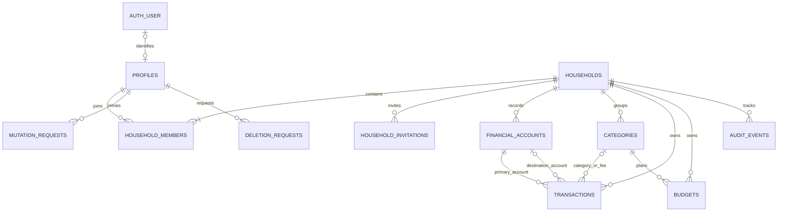

# Desain Database — Cash Flow

Versi 0.2 · PostgreSQL langsung · Rancangan domain dengan SQL implementasi di `migrations/`.

Migration 000–003 telah diterapkan forward-only pada database development/test Cash Flow. SQL migration menjadi acuan nama kolom/constraint aktual; uraian di bawah mempertahankan detail rancangan yang lebih luas. Auth memakai `auth_users`, `auth_sessions`, `auth_accounts`, `auth_verifications`, dan `auth_rate_limits`, dihasilkan dari Better Auth 1.7.11. Role runtime dibatasi pada migration 002. Koreksi fungsi constraint owner diterapkan melalui migration baru 003, tanpa mengubah migration yang telah dijalankan.

Business rule mengacu pada [PRD](PRD.md). Nama tabel di bawah adalah kontrak rancangan; tabel autentikasi mengikuti schema resmi library pada versi yang dipasang.

## 1. Pilihan model

Gunakan satu database relasional bersama dengan `household_id` pada setiap data tenant. Aplikasi mobile hanya mengakses backend, tidak memiliki koneksi/kredensial PostgreSQL.

Satu transaksi transfer disimpan sebagai satu baris berisi rekening asal, rekening tujuan, pokok, dan biaya. Saldo dihitung dari sumber transaksi, tidak disimpan sebagai kolom saldo berjalan. Ini menghindari dua sisi transfer atau saldo cache yang dapat berbeda. Audit bukan event sourcing dan tidak dipakai untuk menghitung saldo.

Otorisasi MVP diterapkan pada setiap interface backend, dengan filter household pada query dan composite foreign key untuk integritas tenant. PostgreSQL RLS belum menjadi lapisan wajib MVP karena database tidak diekspos ke client. Jika ditambahkan, RLS membutuhkan role runtime non-owner, konteks per transaksi, dan pengujian tersendiri; jangan mengklaim RLS sudah aktif.

## 2. ERD

`AUTH_USER` mewakili tabel identitas milik library, bukan tabel baru dengan nama tersebut. `TRANSACTIONS` adalah kejadian finansial, berbeda dari transaksi database `BEGIN/COMMIT`.

## 3. Konvensi

- ID domain: `uuid`; ID identitas library dipertahankan sebagai `text` tanpa konversi paksa.
- Kolom wajib bersifat NOT NULL kecuali ditandai nullable atau timestamp opsional seperti archived_at/deleted_at. Constraint lintas baris yang tidak dapat dinyatakan sebagai CHECK dijalankan melalui foreign key, trigger, atau validasi dalam transaksi backend sebagaimana dijelaskan di setiap bagian.
- Uang: `bigint` satuan rupiah untuk IDR. Wire format berupa string digit, misalnya `"150000"`, bukan JSON floating-point. Saldo negatif memakai tanda minus.
- Batas per nilai sesuai D-07 PRD. Hasil `SUM(bigint)` dipertahankan tepat dan dikirim sebagai string; jangan mengonversi total ke JavaScript `Number`.
- Tanggal transaksi: `date`; waktu sistem/audit: `timestamptz`. Database beroperasi dalam UTC; tanggal default ditentukan dengan timezone household.
- `created_at` dan `updated_at` diisi server. Tabel yang dapat dikoreksi memiliki `version integer NOT NULL DEFAULT 1 CHECK (version > 0)`.
- Nama tabel/kolom `snake_case`; nilai jenis menggunakan text dengan `CHECK` agar perubahan pilihan dapat dimigrasikan secara eksplisit.
- Default foreign key `RESTRICT/NO ACTION` untuk data domain. Tidak ada cascade penghapusan histori ketika anggota dikeluarkan atau akun login dihapus.

## 4. Identitas dan household

### Tabel autentikasi

Better Auth mengelola model user, session, account/provider credential, verification, dan rate-limit ketika storage database diaktifkan. Generate SQL sesuai versi library, tinjau, lalu masukkan ke rangkaian migration proyek. Jangan menulis mekanisme hash password, session, atau reset token sendiri. Nama tabel login `account` berbeda dari tabel rekening uang `financial_accounts`.

### `profiles`

| Kolom | Tipe / ketentuan |
| --- | --- |
| `id` | uuid PK |
| `auth_user_id` | text nullable, UNIQUE FK ke identitas library; `ON DELETE SET NULL` |
| `display_name` | varchar(80), tidak kosong untuk akun aktif |
| `status` | active / deletion_pending / deleted |
| `created_at`, `updated_at`, `deleted_at` | timestamptz; deleted_at nullable |

Profil domain tidak dihapus bersamaan dengan identitas login. Profil yang dihapus kehilangan referensi login dan nama personal; atribusi dibaca sebagai “Pengguna dihapus”. Backend menolak operasi domain untuk profil selain active.

### `households`

| Kolom | Tipe / ketentuan |
| --- | --- |
| `id` | uuid PK |
| `name` | varchar(80), trim, tidak kosong |
| `currency` | char(3), CHECK = IDR pada MVP |
| `timezone` | text IANA; divalidasi server; dikunci setelah pembuatan pada MVP |
| `revision` | bigint default 0, naik setiap mutation household yang berhasil |
| `created_by` | uuid FK profiles, atribusi historis |
| `created_at`, `updated_at`, `deleted_at` | timestamptz; deleted_at menutup akses |
| `version` | integer |

### `household_members`

| Kolom | Tipe / ketentuan |
| --- | --- |
| `id` | uuid PK |
| `household_id`, `profile_id` | FK households / profiles; pasangan UNIQUE |
| `role` | owner / member |
| `status` | active / revoked |
| `joined_at`, `revoked_at` | timestamptz; revoked_at hanya terisi untuk revoked |
| `version` | integer; naik ketika role/status berubah |

Partial unique index pada `household_id WHERE role = 'owner' AND status = 'active'` menjamin paling banyak satu owner. Constraint trigger yang deferred hingga commit memeriksa household tidak dihapus memiliki tepat satu owner aktif. Pembuatan household + owner serta perpindahan owner harus dalam satu transaksi database; pencabutan owner tanpa pengganti ditolak.

Membership lama diaktifkan kembali saat undangan diterima ulang; catat peristiwa join/revoke di audit. Jangan membuat duplikat pasangan household/pengguna.

### `household_invitations`

| Kolom | Tipe / ketentuan |
| --- | --- |
| `id` | uuid PK |
| `household_id`, `invited_by` | FK households / profiles |
| `email_normalized` | text, hanya owner dan penerima yang berhak membaca |
| `status` | pending / accepted / revoked / expired |
| `created_at`, `expires_at`, `accepted_at` | timestamptz |
| `accepted_by` | uuid nullable FK profiles |
| `version` | integer; naik ketika status berubah |

Satu undangan pending per household/email melalui partial unique index. Sebelum mengundang ulang, tandai undangan kedaluwarsa secara atomik. `expires_at > now()` selalu diperiksa saat accept, sehingga expiry tidak bergantung pada cron.

Tautan memuat ID undangan, bukan kredensial. Tidak diperlukan bearer token undangan: pengguna tetap harus login dengan email terverifikasi yang cocok. Endpoint publik tidak mengungkap nama household, email, atau keanggotaannya. Normalisasi email mengikuti identitas library secara konsisten; jangan menghapus titik atau suffix berdasarkan asumsi provider.

## 5. Rekening dan kategori

### `financial_accounts`

| Kolom | Tipe / ketentuan |
| --- | --- |
| `id`, `household_id` | uuid PK dan FK; UNIQUE(household_id, id) |
| `name` | varchar(80), tidak kosong |
| `kind` | bank / cash / ewallet |
| `opening_balance_minor` | bigint, signed, sesuai batas PRD |
| `opening_date` | date, tidak setelah hari ini dalam timezone household |
| `created_by`, `updated_by` | uuid FK profiles |
| `created_at`, `updated_at`, `archived_at` | timestamptz |
| `version` | integer |

Tidak menyimpan nomor rekening lengkap, kredensial bank, atau `current_balance`. Perubahan tanggal awal memeriksa semua transaksi terkait, termasuk rekening tujuan transfer. Arsip bukan penghapusan dan tidak mengeluarkan saldo dari total household.

### `categories`

`id uuid PK`, `household_id uuid FK`, `name varchar(60)`, `kind income|expense`, `created_by uuid FK`, `created_at`, `updated_at`, `archived_at`, `version`.

UNIQUE(household_id, id). Nama aktif unik per household/jenis secara case-insensitive dengan index ekspresi `lower(trim(name))`. Jenis kategori tidak dapat diubah setelah dibuat. Kategori awal dibuat dalam transaksi pembuatan household: Gaji/Lainnya untuk income; Belanja, Makan, Transportasi, Tagihan, Kesehatan, Biaya Admin, dan Lainnya untuk expense.

## 6. Transaksi dan anggaran

### `transactions`

| Kolom | Tipe / ketentuan |
| --- | --- |
| `id`, `household_id` | uuid PK dan FK; UNIQUE(household_id, id) |
| `type` | income / expense / transfer |
| `account_id` | uuid NOT NULL; rekening penerima income, pembayar expense, atau asal transfer |
| `destination_account_id` | uuid nullable; hanya untuk transfer |
| `category_id` | uuid nullable; wajib untuk income/expense |
| `amount_minor` | bigint > 0 dan <= batas PRD |
| `fee_minor` | bigint default 0, 0 <= nilai <= batas PRD; hanya transfer boleh > 0 |
| `fee_category_id` | uuid nullable; wajib tepat ketika fee_minor > 0 |
| `occurred_on` | date NOT NULL |
| `note` | varchar(500) nullable |
| `created_by`, `updated_by`, `deleted_by` | uuid FK profiles; deleted_by nullable |
| `created_at`, `updated_at`, `deleted_at` | timestamptz |
| `version` | integer |

CHECK lokal memastikan bentuk transaksi:

- income/expense: destination null, category terisi, fee = 0, fee_category null.
- transfer: destination terisi dan berbeda dari account_id, category null, serta pasangan fee/category valid.
- deleted_at dan deleted_by harus sama-sama terisi atau sama-sama null.

Composite FK `(household_id, account_id)` dan `(household_id, destination_account_id)` menuju rekening; pasangan household/category menuju categories. Constraint tersebut mencegah referensi lintas tenant, meski kode aplikasi keliru.

Backend memeriksa jenis kategori, tanggal awal kedua rekening, status arsip, nominal, dan hari lokal sebelum mutation. Jenis kategori, currency, timezone, dan household_id suatu entitas tidak boleh dipindahkan melalui endpoint edit. Mutation memakai lock household sehingga validasi arsip/tanggal tidak berlomba dengan mutation lain.

### `budgets`

`id uuid PK`, `household_id uuid FK`, `category_id uuid`, `month_start date`, `limit_minor bigint > 0`, `created_by`, `updated_by`, `created_at`, `updated_at`, `version`.

UNIQUE(household_id, category_id, month_start); composite FK kategori/household; CHECK tanggal adalah hari pertama bulan. Backend memastikan kategori expense dan batas nominal. Hapus anggaran tidak menghapus transaksi; audit tetap dicatat. Pengeluaran kategori tanpa anggaran ditampilkan sebagai “Belum dianggarkan”.

## 7. Riwayat, retry, dan penghapusan akun

### `audit_events`

`id uuid PK`, `household_id uuid FK`, `actor_profile_id uuid FK`, `entity_type text`, `entity_id uuid`, `action text`, `visibility finance|administration`, `changes jsonb`, `created_at timestamptz`.

Append-only bagi runtime: INSERT dan SELECT sesuai permission; UPDATE/DELETE hanya operasi retensi yang terotorisasi. `changes` menggunakan allowlist nilai finansial, referensi, versi, dan status. Jangan simpan password, session, isi email, atau salinan isi catatan bebas; perubahan note cukup `note_changed: true`.

Audit keuangan tersedia bagi anggota aktif. Audit administrasi hanya owner. Pseudonimisasi profil mempertahankan relasi actor tanpa mempertahankan nama/email personal. Audit bukan backup untuk restore transaksi.

### `mutation_requests`

`id uuid PK`, `actor_profile_id uuid FK`, `household_id uuid nullable FK`, `idempotency_key uuid`, `operation text`, `request_hash text`, `result jsonb`, `http_status integer`, `created_at timestamptz`.

UNIQUE(actor_profile_id, idempotency_key). Hash berasal dari method, route termasuk household, dan payload tervalidasi yang dikanonisasi. Simpan hanya hasil sukses minimal: ID resource, versi, dan revision; tidak menyimpan secret atau respons auth. Baris dan mutation bisnis harus commit bersama.

Kunci dipertahankan selama data household masih aktif agar retry lama tidak membuat transaksi baru. Retensinya mengikuti lifecycle household, bukan cache TTL pendek. Duplicate request harus lolos autentikasi dan otorisasi yang berlaku sebelum hasil lama dikembalikan. Household dapat null untuk pembuatan ruang baru, kemudian diisi dengan ID hasil.

### `deletion_requests`

`id uuid PK`, `profile_id uuid FK`, `status requested|processing|completed|failed`, `requested_at`, `completed_at`, `attempt_count integer`, `last_error_code text nullable`, `version integer`.

Satu permintaan belum selesai per profil. Pilihan owner terkait household diselesaikan sebelum tahap pemrosesan destruktif. Proses resumable memutus session/login, mencabut membership, menghapus identitas auth, dan meminimalkan profil sesuai kebijakan final. Jangan menyimpan error mentah atau kredensial dalam tabel ini. Rincian retensi adalah release gate PRD, bukan asumsi bahwa seluruh catatan bersama boleh langsung dihapus.

## 8. Sumber perhitungan yang sama

Rancang view read-only `account_effects` sebagai `UNION ALL` dari sumber berikut. Semua cabang transaksi mengecualikan `deleted_at IS NOT NULL`.

| Sumber | Rekening | signed_minor | flow_kind | Kategori |
| --- | --- | --- | --- | --- |
| Saldo awal | rekening terkait | opening_balance_minor | null | null |
| Income | account_id | +amount_minor | income | category_id |
| Expense | account_id | -amount_minor | expense | category_id |
| Pokok transfer keluar | account_id | -amount_minor | null | null |
| Pokok transfer masuk | destination_account_id | +amount_minor | null | null |
| Biaya transfer, jika > 0 | account_id | -fee_minor | expense | fee_category_id |

Setiap efek membawa household_id, account_id, occurred_on, transaction_id (null untuk saldo awal), dan pencatat. View dihitung, bukan tabel posting kedua. Query selalu memfilter household yang sudah diotorisasi.

- Saldo saat ini: SUM signed_minor per rekening sampai hari lokal ini, termasuk saldo awal.
- Pemasukan periode: SUM signed_minor untuk flow_kind income dalam periode.
- Pengeluaran periode: negatif dari SUM signed_minor untuk flow_kind expense.
- Arus kas: pemasukan − pengeluaran. Saldo awal dan pokok transfer tidak masuk arus kas.
- Terpakai kategori: pengeluaran periode untuk kategori tersebut, termasuk efek biaya transfer.
- Sisa anggaran: limit − terpakai; persentase tidak dibatasi 100%, meski panjang visual progress boleh dibatasi.

Laporan dan ekspor memakai definisi efek yang sama. Ekspor tetap satu baris per transaksi, dengan kolom pokok, biaya, dan efek pemasukan/pengeluaran; jangan mengekspor satu transfer sebagai pemasukan dan pengeluaran pokok. Filter rekening memilih efek rekening tersebut; biaya hanya memengaruhi rekening asal. Kombinasi filter menggunakan aturan yang dijelaskan di UI, bukan join yang menggandakan total.

## 9. Konsistensi mutation

Dalam satu koneksi `pg` dan satu transaksi database:

1. Lock baris household dengan `FOR UPDATE`, kemudian periksa status profil/household dan membership terkini.
2. Claim idempotency key; jika sudah ada, bandingkan hash dan kembalikan hasil sukses yang sama bila akses masih berlaku.
3. Baca resource dengan predicate household, cek expected_version serta aturan referensi.
4. Simpan mutation; naikkan versi resource, tambahkan audit, dan naikkan revision household.
5. Simpan hasil idempotency, lalu COMMIT. Error pada langkah mana pun melakukan ROLLBACK.

Untuk operasi beberapa household seperti penghapusan akun, lock household menurut ID terurut untuk menghindari deadlock. Semua mutation keuangan dan keanggotaan mengikuti urutan lock yang sama. Menserialkan penulisan per household adalah pilihan MVP untuk keluarga; ukur lock wait sebelum mempertimbangkan granularitas lebih kecil.

Pembuatan household adalah pengecualian urutan bootstrap: periksa identitas/profil, claim kunci sebelum membuat baris household, lalu simpan household, owner, kategori awal, audit, serta hasil dalam satu transaksi database. Retry mengotorisasi akses ke hasil household sebelum mengembalikannya. Penerimaan undangan memperoleh household dari undangan yang email tujuannya cocok, lalu mengikuti urutan lock yang sama; client tidak dapat memilih household tujuan yang berbeda.

## 10. Index awal dan migrasi

Selain PK/FK/unique di atas, siapkan index untuk:

- Membership: (profile_id, status, household_id).
- Transaksi aktif: (household_id, occurred_on DESC, created_at DESC, id DESC).
- Referensi transaksi: (household_id, account_id), destination_account_id, category_id, dan fee_category_id; ukur manfaat sebelum menambah index filter lain.
- Undangan: (email_normalized, status, expires_at).
- Audit: (household_id, visibility, created_at DESC, id DESC).
- Penghapusan: (status, requested_at) untuk pemrosesan ulang.

Pencarian awal memakai query berparameter dan ILIKE dengan panjang pencarian dibatasi; full-text/trigram bukan dependency awal. Verifikasi query plan dengan dataset pilot.

Gunakan migration forward-only yang ditinjau. Jalankan terhadap database development/test terpisah terlebih dahulu. Kategori awal dibuat ketika household dibuat, bukan destructive seed startup. Backup serta restore diuji sebelum perubahan data berisiko. Data PostgreSQL dalam Docker disimpan pada named volume; lifecycle container tidak menjadi lifecycle data.

## 11. Validasi desain dan sumber

Skenario uji wajib mengikuti AC-01–AC-12 [PRD](PRD.md), ditambah constraint lintas tenant, kategori salah jenis, tanggal awal, saldo negatif, fee, arsip, penghapusan login, dan batas bigint. Schema ini belum diuji pada instance PostgreSQL.

Sumber teknis: [transaksi node-postgres](https://node-postgres.com/features/transactions), [parameterized queries](https://node-postgres.com/features/queries), [schema Better Auth](https://better-auth.com/docs/concepts/database), serta [PostgreSQL row security](https://www.postgresql.org/docs/current/ddl-rowsecurity.html). Pilihan tabel dan algoritme di atas merupakan rancangan proyek, bukan rekomendasi yang dikutip dari sumber tersebut.
