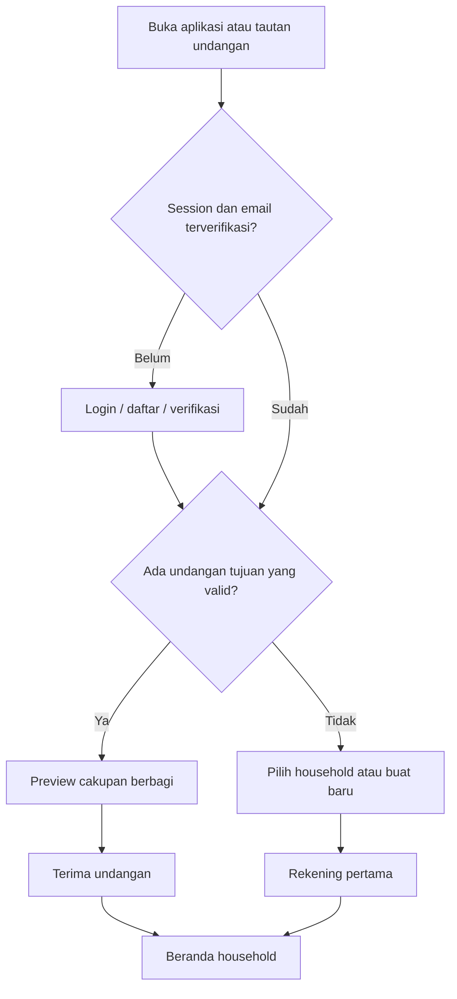

# Rancangan UI/UX — Cash Flow

Versi 0.3 · Spesifikasi alur dan wireframe. Pengguna memilih arah C — Ruang Bersama; [paket visual layar inti](design/RUANG-BERSAMA.md) melengkapi dokumen ini. UI interaktif React Native tersedia di `apps/mobile`, dengan empat tujuan tab dan satu aksi tambah di tengah navigation bar, tema terang/gelap, formulir, dan alur keluarga. Bukti bundle/browser tidak menggantikan pemeriksaan native; lihat [status implementasi](IMPLEMENTATION.md).

Mode layar aplikasi: **Operate** — pengguna menyelesaikan pencatatan atau meninjau angka. Pengguna utama adalah pasangan/anggota keluarga dengan waktu terbatas, termasuk saat menggunakan ponsel dengan satu tangan. Prinsip visual dan perilaku OS ada di [DESIGN.md](../DESIGN.md).

## 1. Arsitektur informasi

```text
Login / Daftar / Verifikasi / Reset password
└─ Pilih atau buat household / Terima undangan
   ├─ Beranda
   │  ├─ Rekening dan saldo
   │  └─ Laporan kategori → transaksi penyusun
   ├─ Transaksi → detail → koreksi / hapus → riwayat perubahan
   ├─ Anggaran → detail kategori → transaksi penyusun
   └─ Keluarga
      ├─ Anggota / undangan / alih owner / keluar
      ├─ Rekening dan kategori
      ├─ Ekspor dan audit
      └─ Pengaturan household / profil / penghapusan akun
```

Pemilih household tersedia melalui nama household pada hero Beranda. Satu layar keuangan selalu mempunyai satu konteks household yang terlihat; tidak ada total gabungan beberapa keluarga. Beranda tidak memakai header tab bawaan: hero emerald menyatukan household, periode, dan saldo, lalu lembar ivory dimulai dengan arus kas dua kolom.

## 2. Daftar layar

| ID   | Layar                    | Informasi dan tindakan utama                                                                   |
| ---- | ------------------------ | ---------------------------------------------------------------------------------------------- |
| S-01 | Login/daftar             | Email, password, tampilkan password, verifikasi, reset                                         |
| S-02 | Pilih household          | Daftar ruang yang diikuti, undangan milik pengguna, buat baru                                  |
| S-03 | Buat household           | Nama, zona waktu, penjelasan IDR dan berbagi data                                              |
| S-04 | Rekening pertama         | Nama, bank/tunai/e-wallet, saldo awal, tanggal mulai; boleh lewati lalu ada panduan            |
| S-05 | Beranda                  | Household, bulan, saldo saat ini, pemasukan/pengeluaran periode, arus kas, transaksi terbaru   |
| S-06 | Tambah/koreksi transaksi | Jenis, nominal, rekening, kategori, tanggal, catatan; field transfer kondisional               |
| S-07 | Daftar transaksi         | Filter, pencarian, daftar terkelompok tanggal, pagination                                      |
| S-08 | Detail transaksi         | Nominal, jenis, referensi, pencatat, pengubah, versi dan riwayat                               |
| S-09 | Anggaran                 | Bulan, kategori, batas, terpakai, sisa, status dan kelola                                      |
| S-10 | Laporan kategori         | Angka utama dan daftar kategori yang dapat ditelusuri; grafik hanya pelengkap                  |
| S-11 | Rekening/kategori        | Daftar aktif/arsip, tambah, koreksi dan arsip                                                  |
| S-12 | Keluarga/undangan        | Anggota, owner, penjelasan akses bersama, undang dan administrasi sesuai role                  |
| S-13 | Preview undangan         | Nama keluarga/pengundang setelah login email cocok, cakupan akses, terima/tolak dengan kembali |
| S-14 | Ekspor/audit             | Pilih periode/filter, jumlah data, share CSV; audit sesuai permission                          |
| S-15 | Profil/lifecycle         | Logout, pengajuan penghapusan akun, status permintaan, pilihan owner terkait household         |

Tidak membuat layar admin platform, billing, atau portal marketing untuk MVP.

## 3. Onboarding dan undangan



Tautan dipertahankan selama login sehingga penerima kembali ke undangannya. Pengguna dengan email berbeda mendapat penjelasan dan pilihan ganti akun; aplikasi tidak membocorkan isi undangan. Domain HTTPS, app links/universal links, serta halaman fallback ditetapkan ketika domain deploy tersedia.

Preview undangan menjelaskan: “Anggota dapat melihat dan mengoreksi rekening, transaksi, serta anggaran keluarga ini, termasuk catatan sebelumnya.” Jangan menyatakan uang bank dapat dipindahkan oleh aplikasi; produk hanya mencatat.

Jika belum ada rekening, Beranda menampilkan langkah tambah rekening dan alasan tombol transaksi belum dapat digunakan. Akun baru tidak diisi transaksi contoh.

## 4. Beranda dan wireframe

Urutan: household → bulan arus kas → saldo saat ini dengan label terpisah → pemasukan/pengeluaran → sisa anggaran yang relevan → transaksi terbaru. Tindakan tambah selalu mudah dijangkau, mengikuti pola OS.

Wireframe berikut memakai data sintetis: saldo awal bank Rp5.000.000, gaji Rp8.000.000, belanja Rp325.000, transfer Rp500.000 ke e-wallet dengan biaya Rp2.500.

```text
Cash Flow                   Keluarga Budi ▾
Oktober 2026                          ‹  ›

SALDO TERCATAT SAAT INI
Rp12.672.500                 Lihat rekening
Termasuk rekening yang diarsipkan

Pemasukan bulan ini             Rp8.000.000
Pengeluaran bulan ini             Rp327.500
Arus kas bersih                 Rp7.672.500

Anggaran Belanja                 Lihat semua
Rp325.000 dari Rp1.500.000
Sisa Rp1.175.000

Transaksi terbaru                 Lihat semua
Transfer Bank → E-wallet            Rp500.000
Biaya admin                           Rp2.500
Belanja                              −Rp325.000
Gaji                               +Rp8.000.000

Beranda | Transaksi | Tambah transaksi | Anggaran | Anggota
```

Biaya pada baris transfer adalah rincian transaksi yang sama, bukan baris kejadian baru yang dihitung dua kali. Saldo bank contoh Rp12.172.500 dan e-wallet Rp500.000. Contoh ini memperluas skenario transfer PRD dengan gaji dan belanja.

Saat bulan diganti, pemasukan/pengeluaran/anggaran mengikuti bulan; saldo utama tetap berlabel “saat ini”. Jangan memberi kesan saldo tersebut adalah saldo akhir bulan yang dipilih.

## 5. Formulir transaksi

Pengeluaran menjadi pilihan awal yang diusulkan. Tanggal default adalah hari ini dalam zona household; rekening terakhir dapat dipilih kembali hanya dalam household yang sama dan jika masih aktif. Kategori tidak ditebak otomatis dari anggota.

| Jenis       | Field wajib                                               | Field opsional                                            |
| ----------- | --------------------------------------------------------- | --------------------------------------------------------- |
| Pemasukan   | Nominal, rekening penerima, kategori pemasukan, tanggal   | Catatan                                                   |
| Pengeluaran | Nominal, rekening pembayar, kategori pengeluaran, tanggal | Catatan                                                   |
| Transfer    | Nominal, rekening asal, rekening tujuan berbeda, tanggal  | Biaya admin; kategori biaya wajib jika biaya > 0; catatan |

```text
Batalkan          Tambah transaksi
[ Pengeluaran | Pemasukan | Transfer ]

Nominal
Rp 325.000

Rekening                 Bank Keluarga ▾
Kategori                       Belanja ▾
Tanggal                 20 Oktober 2026
Catatan (opsional)
[ Belanja kebutuhan mingguan          ]

Dicatat untuk Keluarga Budi
[ Simpan pengeluaran                  ]
```

Gunakan keypad yang sesuai untuk angka IDR. Tolak nominal nol, pecahan, huruf, dan nilai di luar batas; jangan mengubah input ambigu seperti `1,5` menjadi Rp15 diam-diam. Paste yang dikenali sebagai format rupiah dapat dinormalisasi secara deterministik; format ambigu meminta koreksi.

Saat mengganti jenis, bersihkan hanya field yang tidak berlaku setelah menjelaskan jika ada input penting yang hilang. Transfer menampilkan pratinjau “Bank berkurang Rp502.500; E-wallet bertambah Rp500.000” sebelum simpan jika biaya Rp2.500.

Tombol simpan menampilkan progres dan mencegah tap paralel, tetapi pencegahan duplikat tetap dilakukan server. Formulir tidak ditutup sebelum hasil sukses. Pesan “Transaksi tersimpan” muncul setelah konfirmasi server.

## 6. State formulir dan koreksi bersama

| State                 | Tampilan / tindakan                                                                            |
| --------------------- | ---------------------------------------------------------------------------------------------- |
| Belum dikirim         | Field dapat diedit; keluar meminta konfirmasi jika ada perubahan                               |
| Menyimpan             | Indikator pada tombol; isian tetap terlihat                                                    |
| Validasi gagal        | Error pada field; fokus pada kesalahan pertama; semua input lain dipertahankan                 |
| Offline sebelum kirim | “Belum tersimpan. Sambungkan internet untuk menyimpan.”                                        |
| Timeout setelah kirim | “Hasil penyimpanan belum diketahui.” Tawarkan cek/coba lagi dengan payload dan kunci yang sama |
| Konflik versi         | Tampilkan perubahan server dan isian pengguna; jangan menimpa otomatis                         |
| Session berakhir      | Login ulang sebelum retry; isian hanya dipertahankan untuk identitas dan akses yang sama       |
| Akses dicabut         | Tutup konteks household dan bersihkan datanya; tampilkan pesan pada pemilih household          |

Draft hanya berada dalam memori MVP: bertahan dari error request, tidak dijanjikan bertahan setelah aplikasi ditutup paksa. Jangan menyebutnya offline mode atau autosave permanen.

Pada konflik, ringkasan dapat berbunyi: “Nominal diubah menjadi Rp350.000 oleh pasangan. Isian Anda Rp325.000 belum disimpan.” Pengguna meninjau lalu memilih muat data terbaru atau mengajukan ulang koreksi berdasarkan versi terbaru. Transaksi yang sudah dihapus tidak boleh dibuat hidup kembali oleh edit lama.

## 7. Riwayat transaksi dan laporan

Daftar dikelompokkan per tanggal, dengan nama kategori/catatan, rekening, pencatat, dan nominal. Transfer memakai arah rekening, bukan tanda plus/minus yang menyerupai pemasukan/pengeluaran. Detail menampilkan biaya secara terpisah.

Filter aktif terlihat sebagai label yang dapat dihapus; rentang tanggal ditampilkan dalam bahasa pengguna, meski kontrak HTTP menggunakan akhir eksklusif. Tampilan “sampai 31 Oktober” diterjemahkan ke `to=2026-11-01`.

Kategori biaya transfer ikut pencarian/filter kategori pengeluaran. Filter rekening pada laporan hanya menghitung efek pada rekening yang dipilih; rincian transfer tetap menunjukkan asal/tujuan dan biaya aslinya. Pencatat selalu dilabeli “Dicatat oleh”, bukan “Dibayar oleh”.

Pagination mempertahankan posisi scroll. Loading halaman berikut tidak menutupi data sebelumnya. Grafik kategori, jika dipakai, dilengkapi daftar nominal; jangan hanya menampilkan donut tanpa nilai.

## 8. Anggaran

Setiap kategori menunjukkan batas, terpakai, sisa, dan status teks. Usulan status: belum ada pengeluaran, berjalan, mendekati batas pada >= 80%, dan terlampaui pada > 100%. Angka ambang 80% adalah usulan UI, bukan push notification.

Progress visual boleh berhenti pada panjang penuh, tetapi teks tetap menampilkan persentase aktual dan sisa negatif. Tambah/edit anggaran mempunyai kategori expense, bulan, dan batas; duplikat mengarahkan pengguna ke anggaran existing.

Kategori tanpa anggaran ditampilkan terpisah dengan tindakan “Atur anggaran”. Tidak semua pengeluaran wajib mempunyai anggaran sebelum dapat dicatat.

## 9. Household, rekening, dan tindakan berisiko

Owner dan member melihat daftar anggota serta role. Kontrol undangan, cabut anggota, transfer owner, dan penghapusan household hanya tersedia bagi owner, dengan enforcement tetap di server.

- Arsip rekening menjelaskan histori/saldo tetap tercatat dan rekening tidak tersedia untuk transaksi baru.
- Hapus transaksi menyebut jenis, nominal, dan dampak pada perhitungan. Tidak menawarkan Undo yang backend belum mendukung.
- Keluar dari household menjelaskan hilangnya akses; owner diarahkan mengalihkan kepemilikan dahulu.
- Penghapusan household meminta konfirmasi nama dan menjelaskan dampak bagi semua anggota.
- Penghapusan akun dapat diajukan dari Profil; tampilkan status pemrosesan dan kebijakan data bersama yang disahkan. Jangan menyebut menonaktifkan akun sebagai penghapusan selesai.

## 10. Empty, loading, error, dan data ekstrem

| Kondisi                        | Perilaku                                                                              |
| ------------------------------ | ------------------------------------------------------------------------------------- |
| Belum ada household            | Buat atau buka undangan; jangan menampilkan dashboard palsu                           |
| Belum ada transaksi            | Ajakan transaksi pertama; angka nol hanya jika data sukses dibaca                     |
| Hasil filter kosong            | Jelaskan filter aktif dan sediakan reset filter                                       |
| Gagal memuat awal              | Error dengan retry; tidak diganti nominal nol                                         |
| Gagal refresh dengan data lama | Data terakhir diberi label belum diperbarui; retry tersedia setelah akses tetap valid |
| Banyak rekening/kategori       | Pencarian pada pemilih, daftar dapat di-scroll                                        |
| Nama/catatan panjang           | Batas input sesuai schema; wrap label penting, detail untuk isi panjang               |
| Nominal besar / saldo negatif  | Nilai lengkap tetap terbaca; tidak membuat layout keluar layar                        |
| Mode gelap / font besar        | Hierarki, kontras, dan tombol tetap berfungsi                                         |

## 11. Kriteria tinjauan desain

Arah visual C — Ruang Bersama sudah dipilih pengguna. Mockup Beranda, pengeluaran, transfer, daftar transaksi, anggaran, contoh Beranda gelap, dan pengeluaran offline tersedia dalam paket visual. Pilihan arah tidak otomatis menyatakan layar turunan telah disetujui atau implementasi telah tervalidasi. Layar serta state lain harus tetap mengikuti spesifikasi ini ketika dibangun.

Ketika aplikasi tersedia, uji tugas berikut bersama pengguna pilot: membuat ruang, menambah rekening, mencatat pengeluaran, menerima undangan pasangan, memahami biaya transfer, mencari penyebab selisih anggaran, dan memperbaiki konflik transaksi. Catat keberhasilan serta titik bingung; jangan mengklaim usability teruji sebelum sesi dilakukan.

Checklist perangkat: ponsel Android/iPhone, layar sempit, font besar, keyboard terbuka, VoiceOver/TalkBack, Back gesture, safe area, dark mode, koneksi putus, dan session kedaluwarsa. Tablet belum menjadi target pengalaman khusus MVP.
